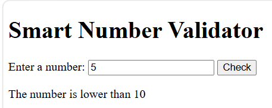
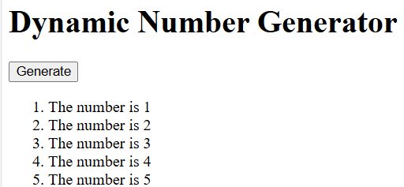

# BIC21203 Lab 4a — Client-Side Scripting (JavaScript)

Name:Burhan Afandi Bin Che Baharuddin  
Student ID:AI240075

## Overview
- Q1: Interactive Text Changer — uses DOM selection, a function, and a click event listener.
- Q2: Smart Number Validator — checks empty, invalid, lower than 10, equal to 10, and higher than 10 inputs.
- Q3: Dynamic Number Generator — creates five list items using a for loop and DOM methods, clearing previous results.

## How to run
Open `Q1/index.html`, `Q2/index.html`, or `Q3/index.html` in a desktop web browser. No installation or external libraries are required.

## Screenshots
- Q1:
- Q2:
- Q3: